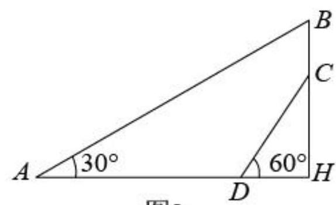
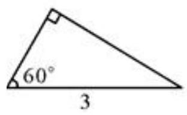

# AVP0507 — Single visual target

MV-MATH:1902_2 / MV-MATH:484_1 · same type · Numeric representation and conversion

## Shared or similar visual information

The numerical notation 60° in both images.

## Evidence locations

- Left image: The 60° to the right of D beside sloping segment DC.
- Right image: The 60° beside the angle arc at the left end of the bottom edge.

## Mathematical meanings

Left image: The marked angle between DC and DH measures 60 degrees. Right image: The marked triangle angle measures 60 degrees.

## Same mathematical meanings

yes

## Rationales

Both labels are attached to marked angle regions and give the same measure of 60°.

Only the selected target is annotated. AI visual-review draft; not independently double-annotated by humans.
