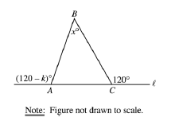
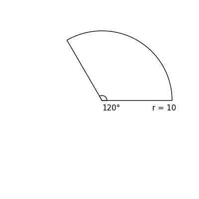

# AVP0508 — Single visual target

MathVista:434 / DynaMath:123 · same type · Numeric representation and conversion

## Shared or similar visual information

The numerical notation 120° in both images.

## Evidence locations

- Left image: The 120° immediately to the right of C above the extended baseline.
- Right image: The 120° below the sector vertex between the two radii.

## Mathematical meanings

Left image: The marked exterior angle at C measures 120 degrees. Right image: The marked central angle of the sector measures 120 degrees.

## Same mathematical meanings

yes

## Rationales

Both labels are attached to marked angle regions and give the same measure of 120°.

Only the selected target is annotated. AI visual-review draft; not independently double-annotated by humans.
