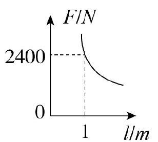
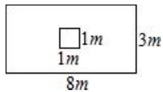

# AVP0510 — Single visual target

MV-MATH:79_1 / MV-MATH:406_2 · different type · Numeric representation and conversion

## Shared or similar visual information

The numerical notations 1 and 1 m.

## Evidence locations

- Left image: The 1 on the l/m axis below the dashed vertical guide.
- Right image: The 1 m below the lower edge of the small inner square.

## Mathematical meanings

Left image: The marked input length l is one meter. Right image: The lower edge of the inner square measures one meter.

## Same mathematical meanings

yes

## Rationales

Each complete label denotes the same length after interpreting the units on the image or axis. The two measurements equal 1 meters.

Only the selected target is annotated. AI visual-review draft; not independently double-annotated by humans.
