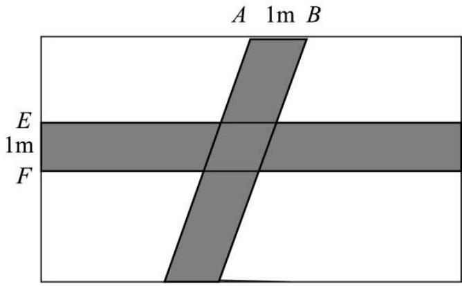
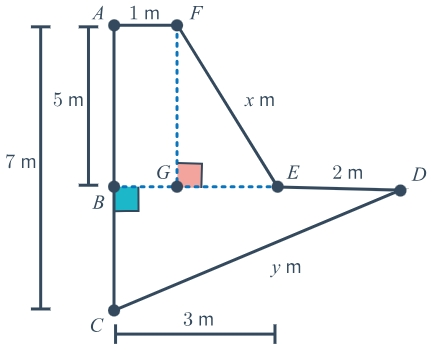

# AVP0511 — Single visual target

MV-MATH:916_1 / MathVerse:368 · same type · Numeric representation and conversion

## Shared or similar visual information

The numerical notation 1 m in both images.

## Evidence locations

- Left image: The 1 m between A and B along the rectangle's top edge.
- Right image: The 1 m above the short horizontal segment AF.

## Mathematical meanings

Left image: The sloping strip spans one meter along AB on the top boundary. Right image: Segment AF has length one meter.

## Same mathematical meanings

yes

## Rationales

In both figures, the label is attached to the indicated span and gives the same length value, 1 m.

Only the selected target is annotated. AI visual-review draft; not independently double-annotated by humans.
