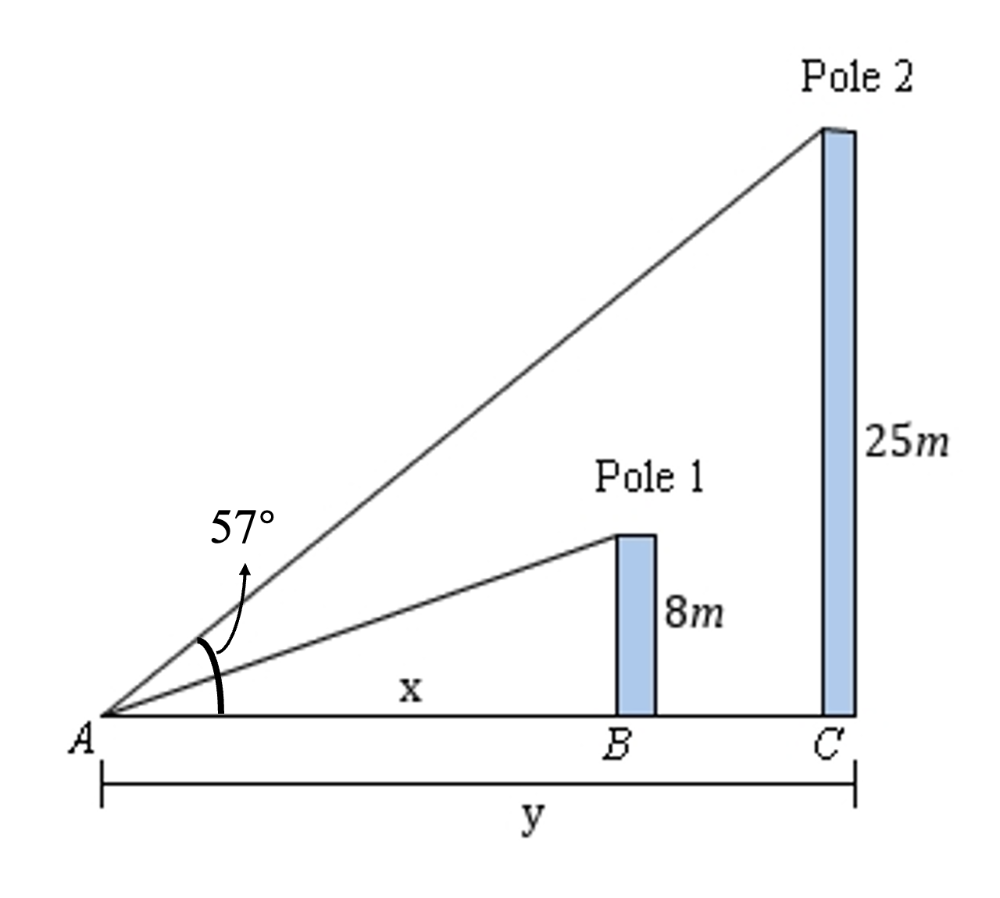
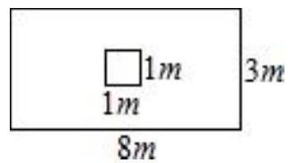

# AVP0512 — Single visual target

MathVerse:351 / MV-MATH:406_2 · same type · Numeric representation and conversion

## Shared or similar visual information

The numerical notation 8 m in both images.

## Evidence locations

- Left image: The 8m printed beside the top end of the shorter pole.
- Right image: The 8 m below the large outer rectangle.

## Mathematical meanings

Left image: The shorter pole is shown with height eight meters. Right image: The outer rectangle's bottom edge measures eight meters.

## Same mathematical meanings

yes

## Rationales

In both figures, the label is attached to the indicated span and gives the same length value, 8 m.

Only the selected target is annotated. AI visual-review draft; not independently double-annotated by humans.
