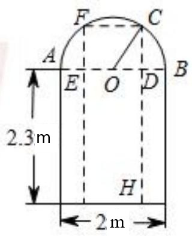
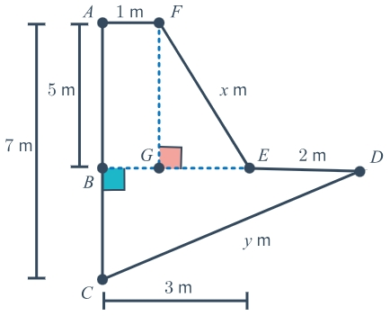

# AVP0513 — Single visual target

MV-MATH:1203_2 / MathVerse:368 · same type · Numeric representation and conversion

## Shared or similar visual information

The numerical notation 2 m in both images.

## Evidence locations

- Left image: The 2 m below the bottom horizontal dimension arrow.
- Right image: The 2 m beside segment ED to the right of E.

## Mathematical meanings

Left image: The opening's width measured by that arrow is two meters. Right image: Segment ED has length two meters.

## Same mathematical meanings

yes

## Rationales

In both figures, the label is attached to the indicated span and gives the same length value, 2 m.

Only the selected target is annotated. AI visual-review draft; not independently double-annotated by humans.
