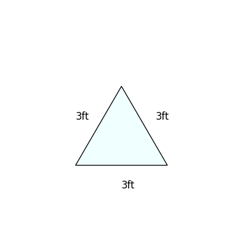

# AVP0514 — Single visual target

MathVista:56 / DynaMath:18 · same type · Numeric representation and conversion

## Shared or similar visual information

The numerical notations 1 yd and 3 ft.

## Evidence locations

- Left image: The 1 yd above the top horizontal side of the orange rectangle.
- Right image: The 3ft printed below the bottom edge of the light-blue triangle.

## Mathematical meanings

Left image: The indicated rectangle side measures one yard. Right image: The triangle base measures three feet.

## Same mathematical meanings

yes

## Rationales

One yard equals three feet. Each complete measurement gives that length.

Only the selected target is annotated. AI visual-review draft; not independently double-annotated by humans.
