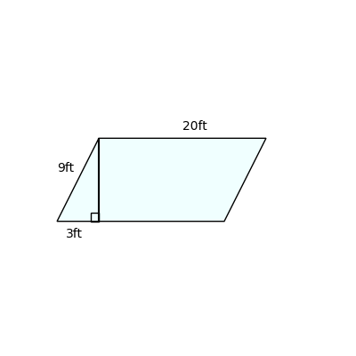
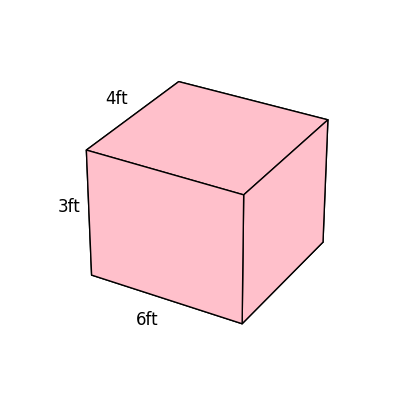

# AVP0515 — Single visual target

DynaMath:34 / DynaMath:74 · different type · Numeric representation and conversion

## Shared or similar visual information

The numerical notation 3 ft in both images.

## Evidence locations

- Left image: The 3ft beneath the short base portion left of the altitude foot.
- Right image: The 3ft next to the left vertical edge of the pink rectangular prism.

## Mathematical meanings

Left image: That short horizontal portion measures three feet. Right image: The vertical edge measures three feet.

## Same mathematical meanings

yes

## Rationales

In both figures, the label is attached to the indicated span and gives the same length value, 3 ft.

Only the selected target is annotated. AI visual-review draft; not independently double-annotated by humans.
