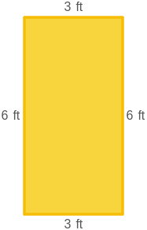
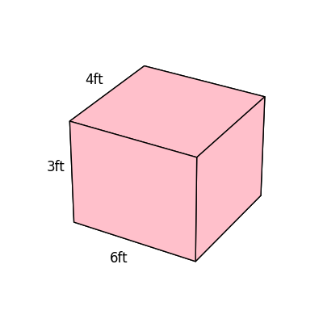

# AVP0516 — Single visual target

MathVista:71 / DynaMath:74 · different type · Numeric representation and conversion

## Shared or similar visual information

The numerical notation 6 ft in both images.

## Evidence locations

- Left image: The 6 ft beside the left side of the yellow rectangle.
- Right image: The 6ft beneath the front bottom edge of the pink rectangular prism.

## Mathematical meanings

Left image: The indicated rectangle side measures six feet. Right image: The front bottom edge measures six feet.

## Same mathematical meanings

yes

## Rationales

In both figures, the label is attached to the indicated span and gives the same length value, 6 ft.

Only the selected target is annotated. AI visual-review draft; not independently double-annotated by humans.
