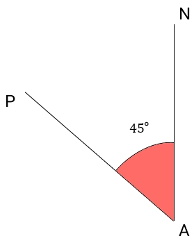
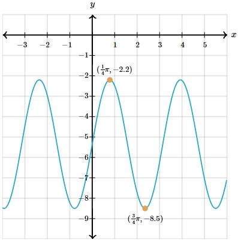

# AVP0516 — Single visual target

MathVerse:331 / MathVerse:530 · different type · Numeric representation and conversion

## Shared or similar visual information

The numerical notations 45° and (1/4)π.

## Evidence locations

- Left image: The single 45° label inside the red angle at A.
- Right image: The (1/4)π expression as the first component of the upper orange point annotation.

## Mathematical meanings

Left image: 45° measures the angle between ray AP and the northward ray at A. Right image: (1/4)π gives the horizontal coordinate of the upper marked point on the function graph.

## Same mathematical meanings

no

## Rationales

45 degrees equals pi/4 radians numerically. The first expression specifies an angle measure, while the second specifies an x-coordinate.

Only the selected target is annotated. AI visual-review draft; not independently double-annotated by humans.
