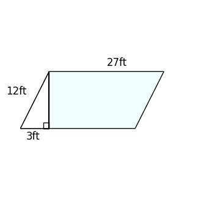
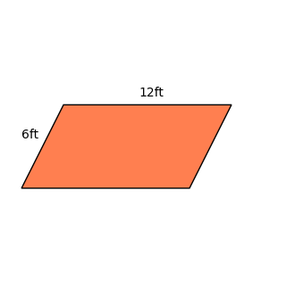

# AVP0517 — Single visual target

DynaMath:189 / DynaMath:41 · same type · Numeric representation and conversion

## Shared or similar visual information

The numerical notation 12 ft in both images.

## Evidence locations

- Left image: The 12ft beside the left sloping edge of the parallelogram.
- Right image: The 12ft above the top horizontal side of the orange parallelogram.

## Mathematical meanings

Left image: The left sloping edge measures twelve feet. Right image: The top side measures twelve feet.

## Same mathematical meanings

yes

## Rationales

In both figures, the label is attached to the indicated span and gives the same length value, 12 ft.

Only the selected target is annotated. AI visual-review draft; not independently double-annotated by humans.
