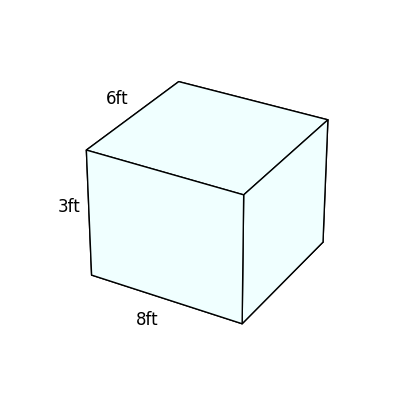
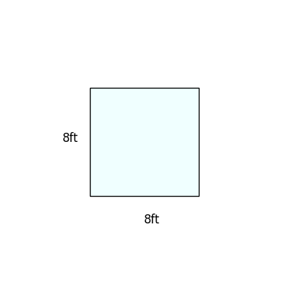

# AVP0518 — Single visual target

DynaMath:36 / DynaMath:17 · different type · Numeric representation and conversion

## Shared or similar visual information

The numerical notation 8 ft in both images.

## Evidence locations

- Left image: The 8ft below the front bottom edge of the pale blue rectangular prism.
- Right image: The 8ft below the bottom side of the pale blue square.

## Mathematical meanings

Left image: The front bottom edge measures eight feet. Right image: The square's bottom side measures eight feet.

## Same mathematical meanings

yes

## Rationales

In both figures, the label is attached to the indicated span and gives the same length value, 8 ft.

Only the selected target is annotated. AI visual-review draft; not independently double-annotated by humans.
