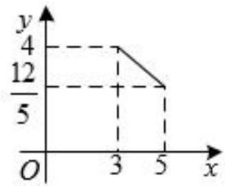
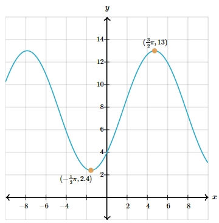

# AVP0519 — Single visual target

MV-MATH:96_1 / MathVerse:532 · same type · Numeric representation and conversion

## Shared or similar visual information

The numerical notations 12/5 (left) and 2.4 (right).

## Evidence locations

- Left image: The notation 12/5 appears on the vertical axis beside the lower dashed guide.
- Right image: The notation 2.4 appears second coordinate of the lower orange point.

## Mathematical meanings

Left image: 12/5 is the output at the right-hand end of the segment. Right image: 2.4 is the vertical coordinate at the marked trough.

## Same mathematical meanings

yes

## Rationales

12/5 and 2.4 denote equal values, and both give a vertical coordinate.

Only the selected target is annotated. AI visual-review draft; not independently double-annotated by humans.
