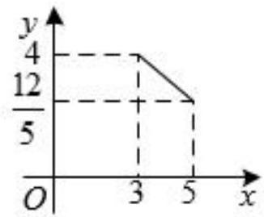
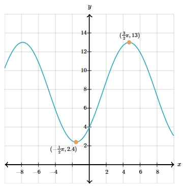

# AVP0519 — Single visual target

MV-MATH:96_1 / MathVerse:532 · same type · Numeric representation and conversion

## Shared or similar visual information

The numerical notations 12/5 and 2.4.

## Evidence locations

- Left image: The stacked fraction 12/5 to the left of the lower horizontal dashed guide.
- Right image: The second component 2.4 in the orange point label with first component −(1/2)π.

## Mathematical meanings

Left image: The vertical coordinate of the right segment endpoint is 12/5. Right image: The selected orange point has y-coordinate 2.4.

## Same mathematical meanings

yes

## Rationales

The fraction 12/5 is exactly 2.4. Each expression gives the vertical coordinate of a marked point.

Only the selected target is annotated. AI visual-review draft; not independently double-annotated by humans.
