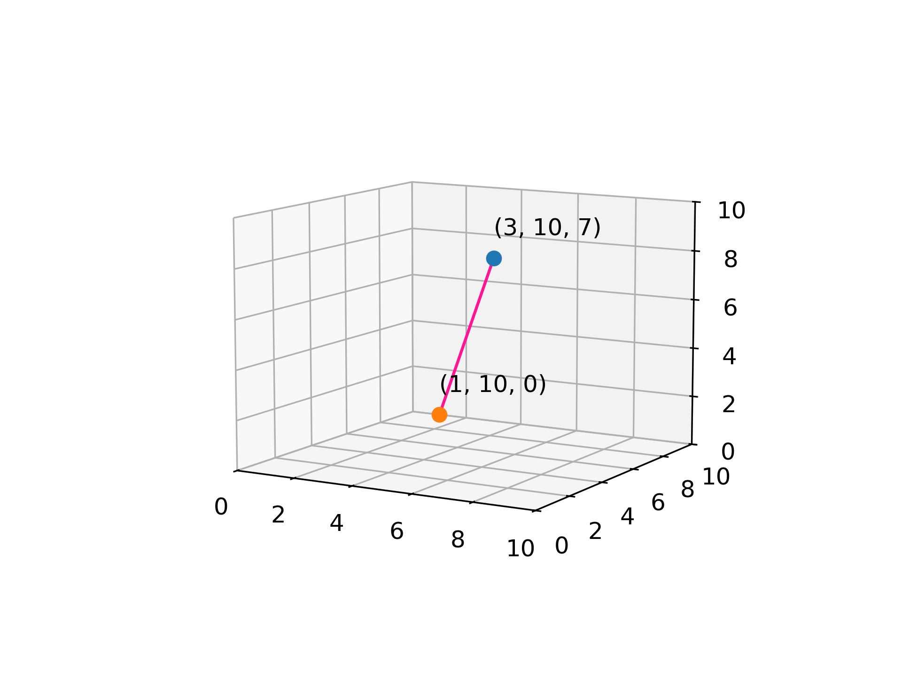
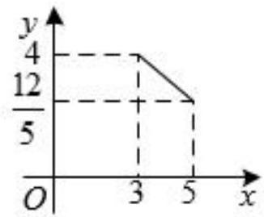

# AVP0520 — Single visual target

DynaMath:318 / MV-MATH:96_1 · different type · Numeric representation and conversion

## Shared or similar visual information

The numerical notation 3 in both images.

## Evidence locations

- Left image: The initial 3 in the blue point label (3, 10, 7).
- Right image: The 3 below the left vertical dashed guide at the first end of the segment.

## Mathematical meanings

Left image: The blue point's first coordinate is 3. Right image: The horizontal coordinate of the left segment endpoint is 3.

## Same mathematical meanings

yes

## Rationales

Both cues identify the same horizontal coordinate value, 3. The evidence is the selected axis position or coordinate component in each image.

Only the selected target is annotated. AI visual-review draft; not independently double-annotated by humans.
