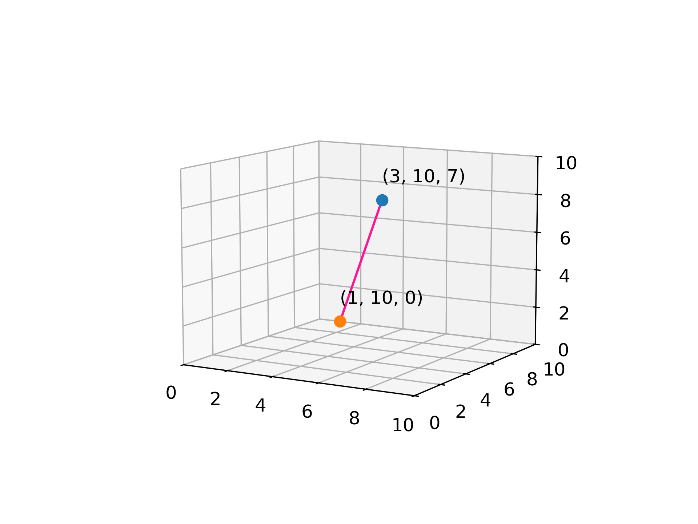
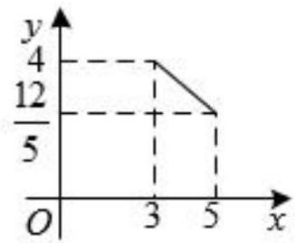

# AVP0520 — Single visual target

DynaMath:318 / MV-MATH:96_1 · different type · Numeric representation and conversion

## Shared or similar visual information

The numerical notation 3.

## Evidence locations

- Left image: The notation 3 appears first entry of the blue point label (3, 10, 7).
- Right image: The notation 3 appears on the x-axis beneath the first vertical guide.

## Mathematical meanings

Left image: 3 gives the first coordinate of the blue point. Right image: 3 is the horizontal coordinate of the segment's left endpoint.

## Same mathematical meanings

yes

## Rationales

The numeral gives the same horizontal coordinate in both images.

Only the selected target is annotated. AI visual-review draft; not independently double-annotated by humans.
