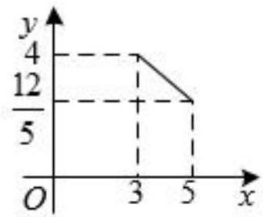
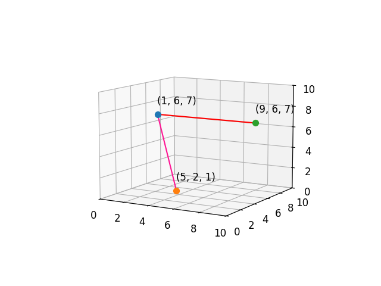

# AVP0521 — Single visual target

MV-MATH:96_1 / DynaMath:320 · different type · Numeric representation and conversion

## Shared or similar visual information

The numerical notation 5.

## Evidence locations

- Left image: The notation 5 appears on the x-axis beneath the second vertical guide.
- Right image: The notation 5 appears first entry of the orange point label (5, 2, 1).

## Mathematical meanings

Left image: 5 is the horizontal coordinate of the segment's right endpoint. Right image: 5 gives the first coordinate of the orange point.

## Same mathematical meanings

yes

## Rationales

The numeral gives the same horizontal coordinate in both images.

Only the selected target is annotated. AI visual-review draft; not independently double-annotated by humans.
