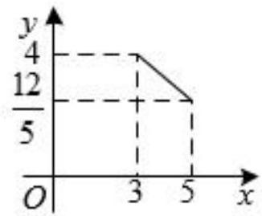
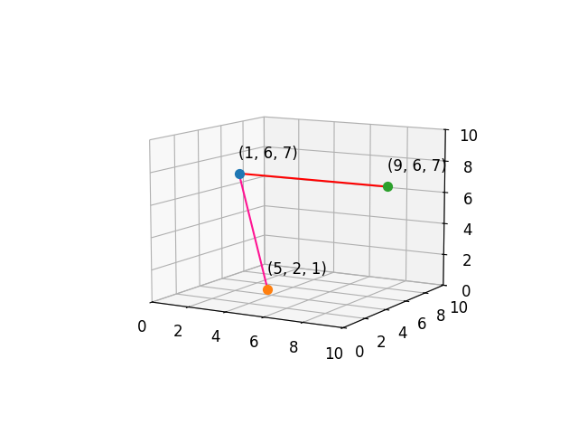

# AVP0521 — Single visual target

MV-MATH:96_1 / DynaMath:320 · different type · Numeric representation and conversion

## Shared or similar visual information

The numerical notation 5 in both images.

## Evidence locations

- Left image: The 5 below the right vertical dashed guide at the second end of the segment.
- Right image: The initial 5 in the orange point label (5, 2, 1).

## Mathematical meanings

Left image: The horizontal coordinate of the right segment endpoint is 5. Right image: The orange point's first coordinate is 5.

## Same mathematical meanings

yes

## Rationales

Both cues identify the same horizontal coordinate value, 5. The evidence is the selected axis position or coordinate component in each image.

Only the selected target is annotated. AI visual-review draft; not independently double-annotated by humans.
