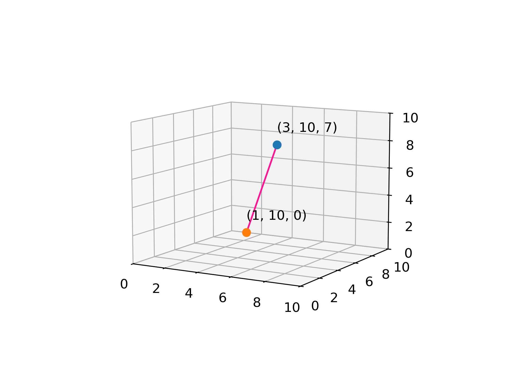
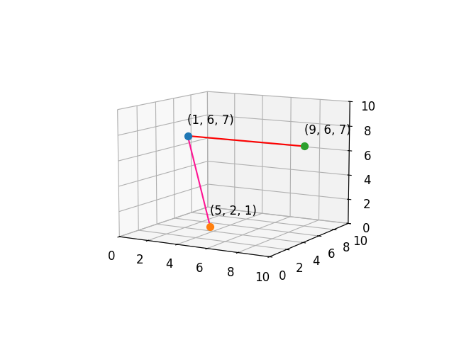

# AVP0522 — Single visual target

DynaMath:318 / DynaMath:320 · same type · Numeric representation and conversion

## Shared or similar visual information

The numerical notation 7 in both images.

## Evidence locations

- Left image: The final 7 in the label (3, 10, 7) beside the blue point.
- Right image: The final 7 in the label (1, 6, 7) beside the blue point.

## Mathematical meanings

Left image: The blue point's third coordinate is 7. Right image: The blue point's third coordinate is 7.

## Same mathematical meanings

yes

## Rationales

Both cues identify the same third coordinate value, 7. The evidence is the selected axis position or coordinate component in each image.

Only the selected target is annotated. AI visual-review draft; not independently double-annotated by humans.
