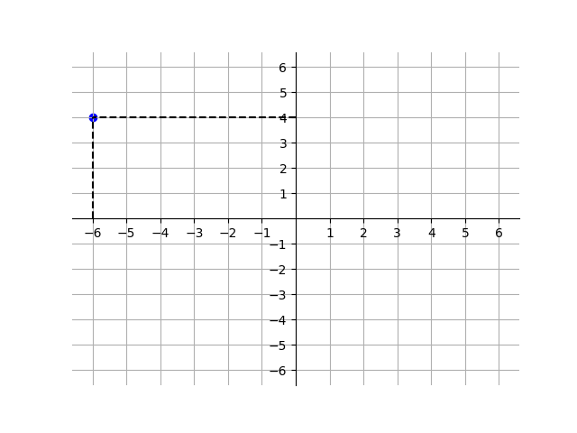
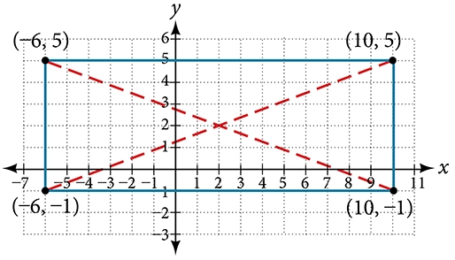

# AVP0523 — Single visual target

DynaMath:363 / MathVerse:433 · same type · Numeric representation and conversion

## Shared or similar visual information

The numerical notation −6 in both images.

## Evidence locations

- Left image: The −6 below the dashed vertical guide from the blue point.
- Right image: The initial −6 in the lower-left rectangle vertex label (−6,−1).

## Mathematical meanings

Left image: The selected blue point has x-coordinate negative six. Right image: The indicated rectangle vertex has x-coordinate negative six.

## Same mathematical meanings

yes

## Rationales

Both cues identify the same horizontal coordinate value, −6. The evidence is the selected axis position or coordinate component in each image.

Only the selected target is annotated. AI visual-review draft; not independently double-annotated by humans.
