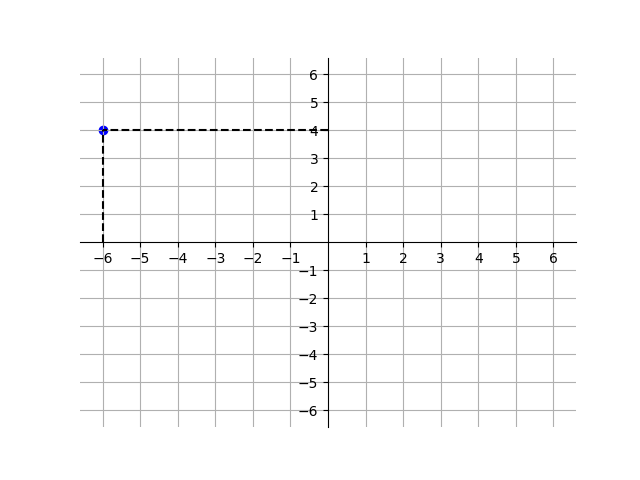
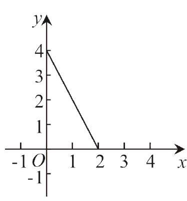

# AVP0524 — Single visual target

DynaMath:363 / MV-MATH:1999_1 · different type · Numeric representation and conversion

## Shared or similar visual information

The numerical notation 4 in both images.

## Evidence locations

- Left image: The 4 beside the end of the horizontal dashed guide from the blue point.
- Right image: The 4 beside the top labeled vertical-axis tick where the line segment begins.

## Mathematical meanings

Left image: The selected blue point has y-coordinate 4. Right image: The sloping segment meets the vertical axis at y-coordinate 4.

## Same mathematical meanings

yes

## Rationales

Both cues identify the same vertical coordinate value, 4. The evidence is the selected axis position or coordinate component in each image.

Only the selected target is annotated. AI visual-review draft; not independently double-annotated by humans.
