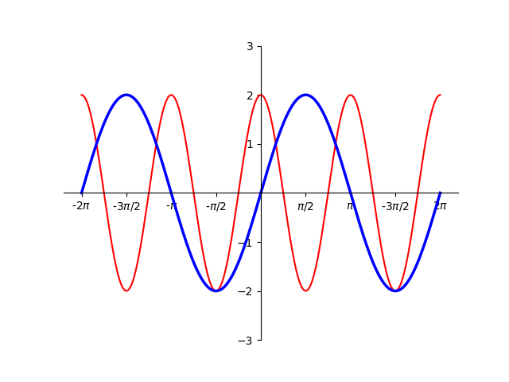

# AVP0525 — Single visual target

DynaMath:14 / MathVista:592 · same type · Numeric representation and conversion

## Shared or similar visual information

The numerical notation π/2 in both images.

## Evidence locations

- Left image: The π/2 beneath the first positive special-value tick of the horizontal axis.
- Right image: The π/2 beneath the first positive special-value tick of the horizontal axis.

## Mathematical meanings

Left image: The tick denotes horizontal coordinate π/2. Right image: The selected horizontal tick denotes x-coordinate π/2.

## Same mathematical meanings

yes

## Rationales

Both cues identify the same horizontal coordinate value, π/2. The evidence is the selected axis position or coordinate component in each image.

Only the selected target is annotated. AI visual-review draft; not independently double-annotated by humans.
