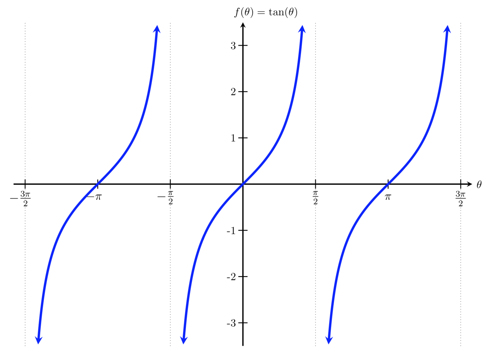
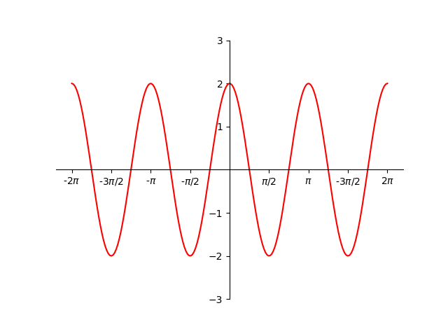

# AVP0526 — Single visual target

MathVista:661 / DynaMath:12 · same type · Numeric representation and conversion

## Shared or similar visual information

The numerical notation −π/2 in both images.

## Evidence locations

- Left image: The −π/2 beneath the first negative special-value tick of the tangent plot's horizontal axis.
- Right image: The −π/2 below the labeled tick immediately to the left of the vertical axis.

## Mathematical meanings

Left image: The selected horizontal tick denotes coordinate −π/2. Right image: The tick denotes horizontal coordinate negative π/2.

## Same mathematical meanings

yes

## Rationales

Both cues identify the same horizontal coordinate value, −π/2. The evidence is the selected axis position or coordinate component in each image.

Only the selected target is annotated. AI visual-review draft; not independently double-annotated by humans.
