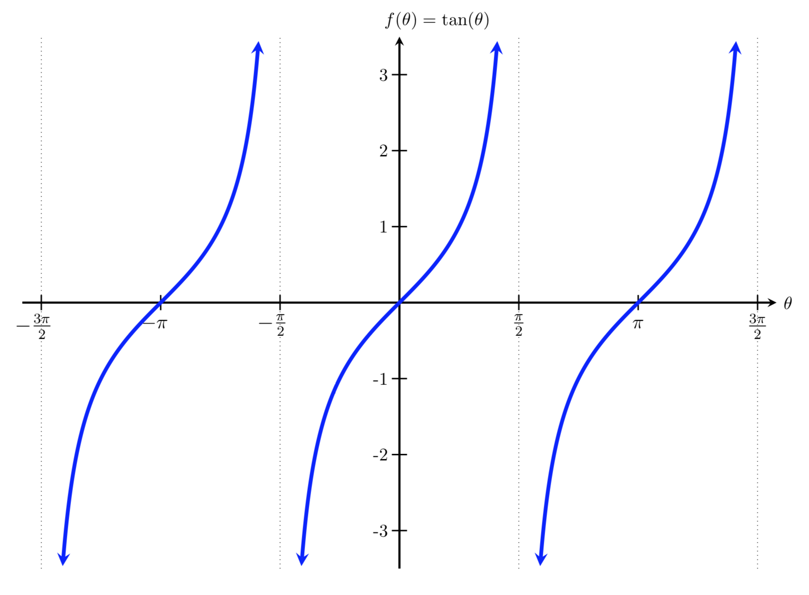
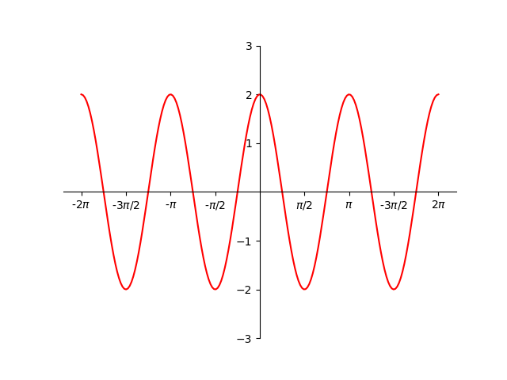

# AVP0526 — Single visual target

MathVista:661 / DynaMath:12 · same type · Numeric representation and conversion

## Shared or similar visual information

The numerical notation −π.

## Evidence locations

- Left image: The notation −π appears at the negative tangent zero on the horizontal axis.
- Right image: The notation −π appears the x-axis tick between −3π/2 and −π/2.

## Mathematical meanings

Left image: −π gives the angle input at the marked negative zero. Right image: −π is the horizontal input coordinate at that tick.

## Same mathematical meanings

yes

## Rationales

The numeral gives the same horizontal coordinate in both images.

Only the selected target is annotated. AI visual-review draft; not independently double-annotated by humans.
