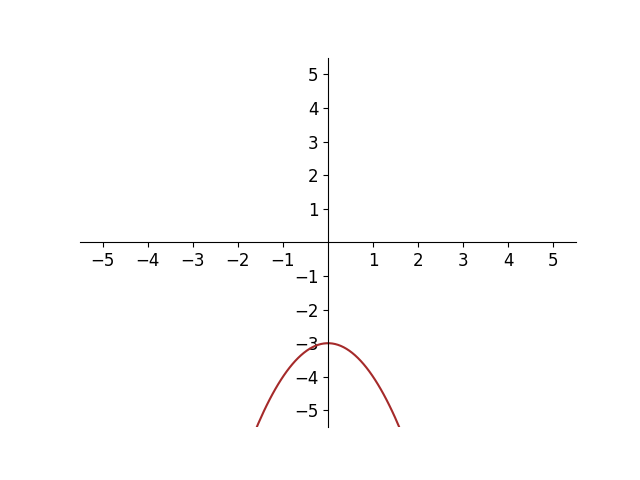

# AVP0527 — Single visual target

DynaMath:69 / MathVerse:437 · different type · Numeric representation and conversion

## Shared or similar visual information

The numerical notation −3 in both images.

## Evidence locations

- Left image: The −3 on the vertical axis at the highest point of the red parabola.
- Right image: The −3 in the lower vertex's coordinate pair (−1,−3).

## Mathematical meanings

Left image: The red parabola's vertex has y-coordinate negative three. Right image: The lower vertex has y-coordinate negative three.

## Same mathematical meanings

yes

## Rationales

Both cues identify the same vertical coordinate value, −3. The evidence is the selected axis position or coordinate component in each image.

Only the selected target is annotated. AI visual-review draft; not independently double-annotated by humans.
