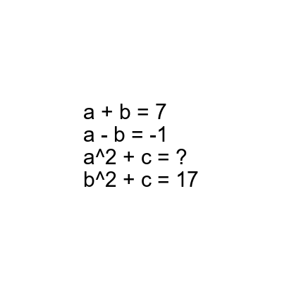

# AVP0528 — Single visual target

MathVista:137 / DynaMath:499 · different type · Numeric representation and conversion

## Shared or similar visual information

The numerical notation 2 in both images.

## Evidence locations

- Left image: The superscript 2 on x in the parabola's label f(x) = x².
- Right image: The 2 after the caret on a in the equation a^2 + c = ?.

## Mathematical meanings

Left image: The formula uses the second power of x. Right image: The expression raises a to the second power.

## Same mathematical meanings

yes

## Rationales

The raised numeral or caret gives the power to which the preceding variable is raised. Both powers are 2.

Only the selected target is annotated. AI visual-review draft; not independently double-annotated by humans.
