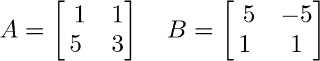
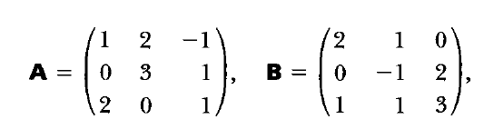

# AVP0529 — Single visual target

DynaMath:485 / MathVista:577 · same type · Numeric representation and conversion

## Shared or similar visual information

The numerical notation 1 in both images.

## Evidence locations

- Left image: The 1 in the top-left position of matrix A.
- Right image: The 1 in the top-left position of matrix A.

## Mathematical meanings

Left image: Matrix A has entry 1 at row 1, column 1. Right image: Matrix A has entry 1 at row 1, column 1.

## Same mathematical meanings

yes

## Rationales

The value 1 occupies the corresponding indicated matrix entry in both arrays.

Only the selected target is annotated. AI visual-review draft; not independently double-annotated by humans.
