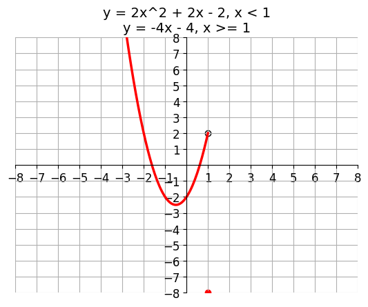
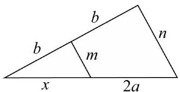

# AVP0530 — Single visual target

DynaMath:88 / MV-MATH:527_1 · different type · Numeric representation and conversion

## Shared or similar visual information

The numerical notation 2 in both images.

## Evidence locations

- Left image: The 2 immediately preceding x in the first term of 2x^2 + 2x − 2.
- Right image: The 2 in the length expression 2a beneath the right-hand base segment.

## Mathematical meanings

Left image: The quadratic term has coefficient 2. Right image: The 2 multiplies a in the expression for the right-hand base segment length.

## Same mathematical meanings

yes

## Rationales

In both expressions, the 2 immediately before the selected term is the multiplier of that term.

Only the selected target is annotated. AI visual-review draft; not independently double-annotated by humans.
