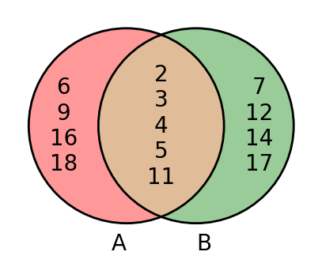
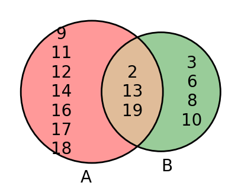

# AVP0532 — Single visual target

DynaMath:470 / DynaMath:469 · same type · Numeric representation and conversion

## Shared or similar visual information

The numerical notation 2 in both images.

## Evidence locations

- Left image: The 2 at the top of the overlapping portion of the circles A and B.
- Right image: The 2 printed in the overlap of the sets A and B.

## Mathematical meanings

Left image: The number 2 is listed as an element of the intersection of the two sets. Right image: The number 2 is a listed member of both sets.

## Same mathematical meanings

yes

## Rationales

The number 2 is printed inside the overlapping portions of the two sets in both diagrams, indicating membership in both sets.

Only the selected target is annotated. AI visual-review draft; not independently double-annotated by humans.
