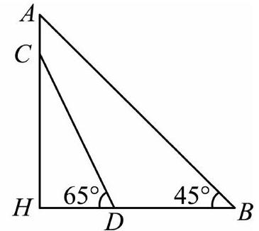
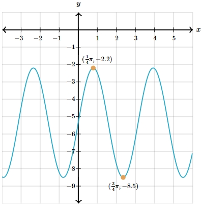

# AVP0533 — Single visual target

MV-MATH:1854_2 / MathVerse:530 · different type · Numeric representation and conversion

## Shared or similar visual information

The numerical notations 45° and (1/4)π.

## Evidence locations

- Left image: The 45° inside the lower-right vertex B of triangle ABH.
- Right image: The first component (1/4)π of the upper orange point's coordinate label.

## Mathematical meanings

Left image: The angle between BA and BH at B measures 45 degrees. Right image: The upper orange point has x-coordinate π/4.

## Same mathematical meanings

no

## Rationales

45 degrees equals π/4 radians as an angle conversion. Here the degree label measures an angle while the π expression specifies a point’s horizontal coordinate.

Only the selected target is annotated. AI visual-review draft; not independently double-annotated by humans.
