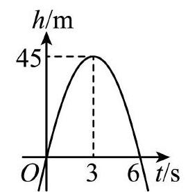
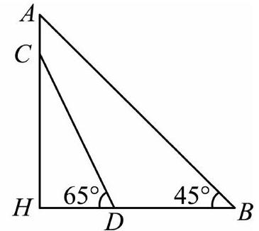

# AVP0534 — Single visual target

MV-MATH:624_1 / MV-MATH:1854_2 · different type · Numeric representation and conversion

## Shared or similar visual information

The numerical notations 45 and 45°.

## Evidence locations

- Left image: The 45 on the h/m axis beside the dashed guide from the apex.
- Right image: The 45° inside the lower-right vertex B of triangle ABH.

## Mathematical meanings

Left image: The apex has height 45 meters. Right image: The angle between BA and BH at B measures 45 degrees.

## Same mathematical meanings

no

## Rationales

The left context gives the number the role of length with a specified unit, while the right context gives it the role of angle measure.

Only the selected target is annotated. AI visual-review draft; not independently double-annotated by humans.
