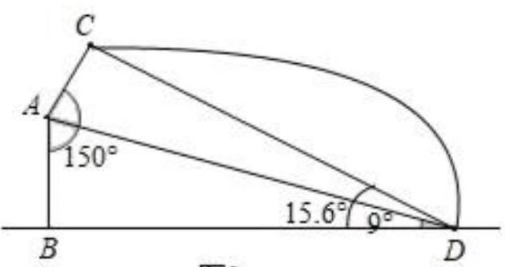
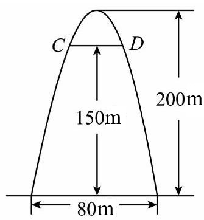

# AVP0535 — Single visual target

MV-MATH:1889_2 / MV-MATH:628_2 · same type · Numeric representation and conversion

## Shared or similar visual information

The numerical notations 150° (left) and 150 m (right).

## Evidence locations

- Left image: The notation 150° appears beside the arc at A.
- Right image: The notation 150 m appears inside the parabola beside the shorter vertical dimension arrow.

## Mathematical meanings

Left image: 150° measures the marked angle at A. Right image: 150 m gives the height of horizontal segment CD above the base.

## Same mathematical meanings

no

## Rationales

The notation on the left represents an angle measure. The notation on the right represents a height.

Only the selected target is annotated. AI visual-review draft; not independently double-annotated by humans.
