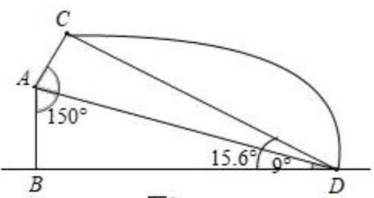
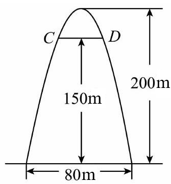

# AVP0535 — Single visual target

MV-MATH:1889_2 / MV-MATH:628_2 · same type · Numeric representation and conversion

## Shared or similar visual information

The numerical notations 150° and 150 m.

## Evidence locations

- Left image: The 150° beside the larger marked angle at A.
- Right image: The 150 m beside the central vertical arrow from the baseline up to CD.

## Mathematical meanings

Left image: The indicated angle at A measures 150 degrees. Right image: The vertical distance from the baseline to chord CD is 150 meters.

## Same mathematical meanings

no

## Rationales

The left context gives the number the role of angle measure, while the right context gives it the role of length with a specified unit.

Only the selected target is annotated. AI visual-review draft; not independently double-annotated by humans.
