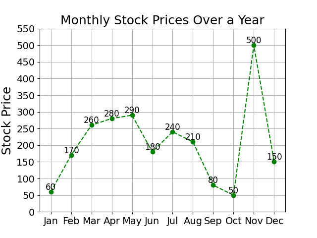
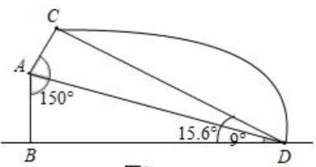

# AVP0536 — Single visual target

DynaMath:382 / MV-MATH:1889_2 · different type · Numeric representation and conversion

## Shared or similar visual information

The numerical notations 150 and 150°.

## Evidence locations

- Left image: The 150 printed beside the December point in the line chart.
- Right image: The 150° beside the larger marked angle at A.

## Mathematical meanings

Left image: The displayed December stock price is 150. Right image: The indicated angle at A measures 150 degrees.

## Same mathematical meanings

no

## Rationales

The left context gives the number the role of stock price, while the right context gives it the role of angle measure.

Only the selected target is annotated. AI visual-review draft; not independently double-annotated by humans.
