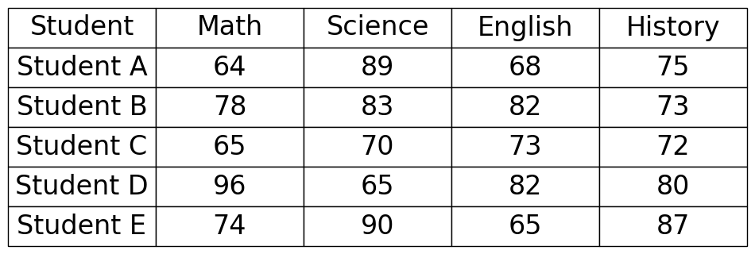
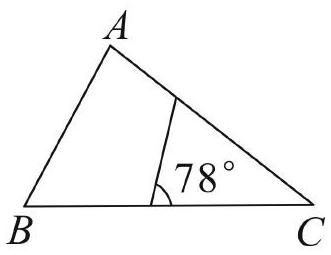

# AVP0538 — Single visual target

DynaMath:424 / MV-MATH:526_1 · different type · Numeric representation and conversion

## Shared or similar visual information

The numerical notations 78 and 78°.

## Evidence locations

- Left image: The 78 in Student B's Math cell.
- Right image: The 78° next to the angle arc where the interior segment meets base BC.

## Mathematical meanings

Left image: The table records Student B's mathematics score as 78. Right image: The indicated angle between the interior segment and the rightward base ray measures 78 degrees.

## Same mathematical meanings

no

## Rationales

The left context gives the number the role of score, while the right context gives it the role of angle measure.

Only the selected target is annotated. AI visual-review draft; not independently double-annotated by humans.
