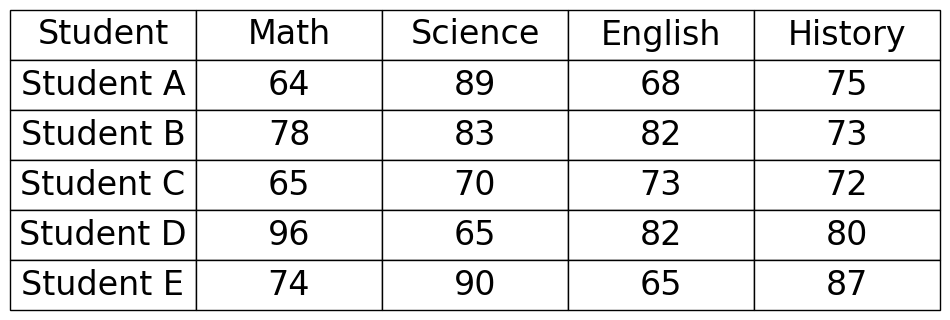
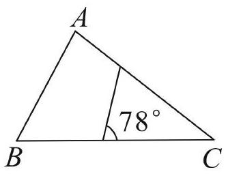

# AVP0538 — Single visual target

DynaMath:424 / MV-MATH:526_1 · different type · Numeric representation and conversion

## Shared or similar visual information

The numerical notations 78 (left) and 78° (right).

## Evidence locations

- Left image: The notation 78 appears Student B row and Math column.
- Right image: The notation 78° appears beside the arc where the interior segment meets BC.

## Mathematical meanings

Left image: 78 is Student B's math score. Right image: 78° measures the marked angle at the foot of the interior segment.

## Same mathematical meanings

no

## Rationales

The notation on the left represents a tabulated score. The notation on the right represents an angle measure.

Only the selected target is annotated. AI visual-review draft; not independently double-annotated by humans.
