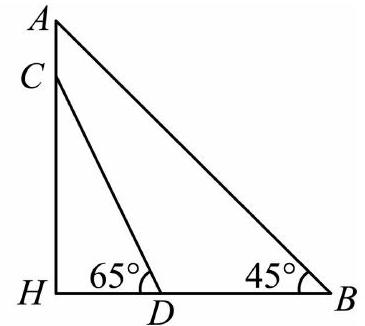
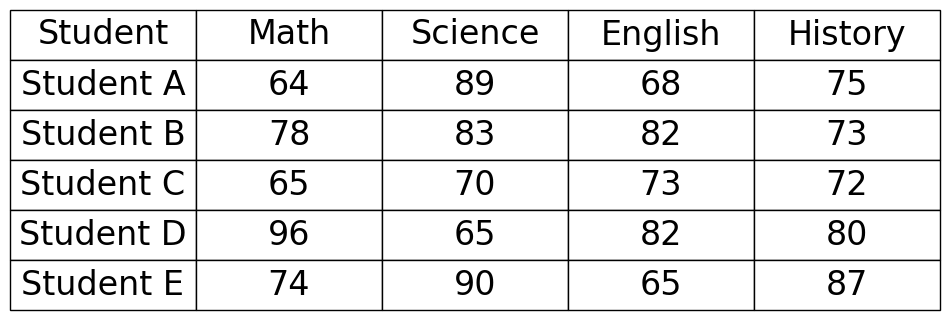

# AVP0539 — Single visual target

MV-MATH:1854_2 / DynaMath:424 · different type · Numeric representation and conversion

## Shared or similar visual information

The numerical notations 65° and 65.

## Evidence locations

- Left image: The 65° beside D, between the leftward horizontal ray and DC.
- Right image: The 65 in Student C's Math cell.

## Mathematical meanings

Left image: The marked angle between DH and DC measures 65 degrees. Right image: The table records Student C's mathematics score as 65.

## Same mathematical meanings

no

## Rationales

The left context gives the number the role of angle measure, while the right context gives it the role of score.

Only the selected target is annotated. AI visual-review draft; not independently double-annotated by humans.
