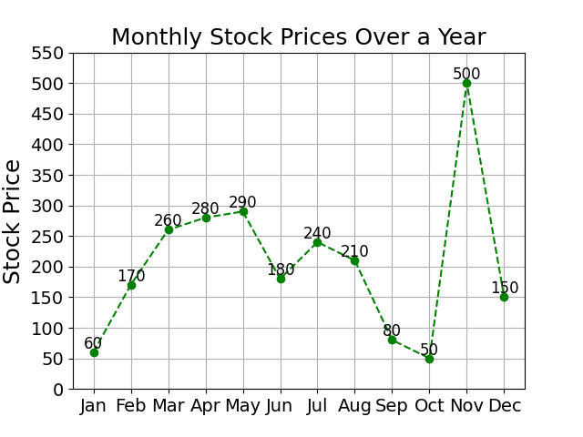
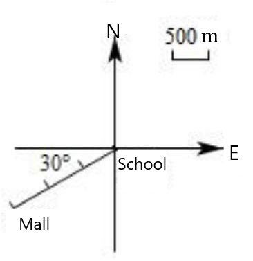

# AVP0540 — Single visual target

DynaMath:382 / MV-MATH:359_1 · different type · Numeric representation and conversion

## Shared or similar visual information

The numerical notations 500 and 500 m.

## Evidence locations

- Left image: The 500 printed above the November point in the line chart.
- Right image: The 500 m above the short scale bar at the upper right.

## Mathematical meanings

Left image: The displayed November stock price is 500. Right image: The scale bar represents 500 meters of actual distance.

## Same mathematical meanings

no

## Rationales

The left context gives the number the role of stock price, while the right context gives it the role of actual distance indicated by a map scale.

Only the selected target is annotated. AI visual-review draft; not independently double-annotated by humans.
