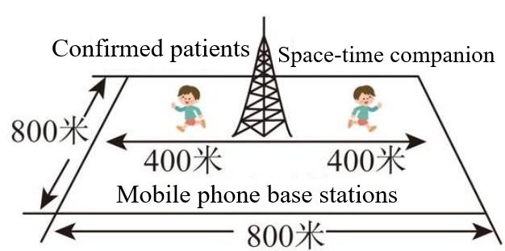
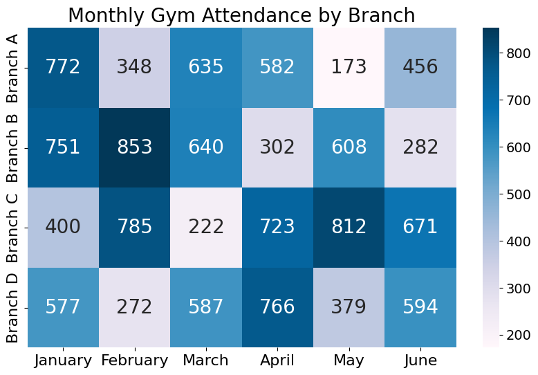

# AVP0541 — Single visual target

MV-MATH:846_1 / DynaMath:452 · different type · Numeric representation and conversion

## Shared or similar visual information

The numeral 400, with a meter unit on the left and a bare value on the right.

## Evidence locations

- Left image: 400 followed by the Chinese unit for meters, beside the left horizontal arrow extending from the mobile phone base station.
- Right image: The 400 printed in the Branch C, January cell of the attendance heatmap.

## Mathematical meanings

Left image: The distance from the station to the left limit shown by the arrow is 400 meters. Right image: The heatmap reports attendance 400 for Branch C in January.

## Same mathematical meanings

no

## Rationales

The left context gives the number the role of length with a specified unit, while the right context gives it the role of attendance count.

Only the selected target is annotated. AI visual-review draft; not independently double-annotated by humans.
