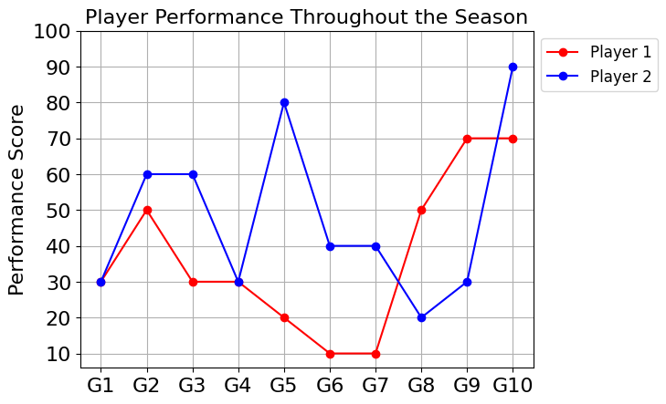
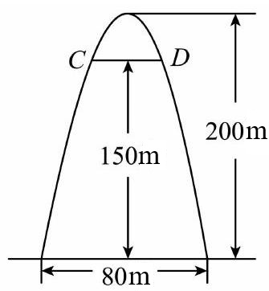

# AVP0542 — Single visual target

DynaMath:386 / MV-MATH:628_2 · different type · Numeric representation and conversion

## Shared or similar visual information

The numerical notations 80 and 80 m.

## Evidence locations

- Left image: The 80 on the performance-score axis at the level of Player 2's G5 marker.
- Right image: The 80 m below the horizontal dimension arrow spanning the arch base.

## Mathematical meanings

Left image: Player 2's plotted performance score at G5 is 80. Right image: The total horizontal width at the arch base is 80 meters.

## Same mathematical meanings

no

## Rationales

The left context gives the number the role of score, while the right context gives it the role of length with a specified unit.

Only the selected target is annotated. AI visual-review draft; not independently double-annotated by humans.
