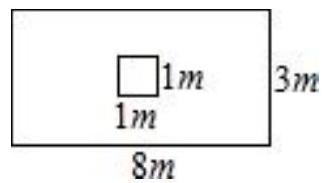
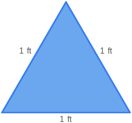

# AVP0543 — Single visual target

MV-MATH:406_2 / MathVista:944 · same type · Numeric representation and conversion

## Shared or similar visual information

The numerical notations 1 m and 1 ft.

## Evidence locations

- Left image: The 1 m below the lower edge of the small inner square.
- Right image: The 1 ft beside the left side of the blue triangle.

## Mathematical meanings

Left image: The lower edge of the inner square measures one meter. Right image: The indicated triangle side measures one foot.

## Same mathematical meanings

no

## Rationales

The labels share a numeral, and the displayed units give different physical lengths of 1 meters and 0.3048 meters.

Only the selected target is annotated. AI visual-review draft; not independently double-annotated by humans.
