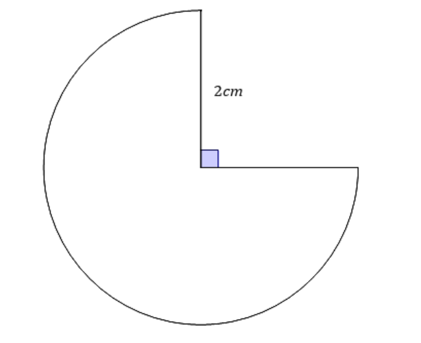
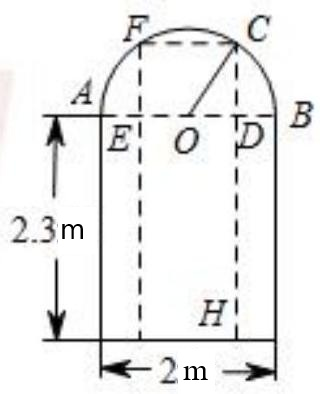

# AVP0544 — Single visual target

MathVerse:394 / MV-MATH:1203_2 · same type · Numeric representation and conversion

## Shared or similar visual information

The numerical notations 2 cm and 2 m.

## Evidence locations

- Left image: The 2cm next to the upright radius of the circle with the quarter cutout.
- Right image: The 2 m below the bottom horizontal dimension arrow.

## Mathematical meanings

Left image: The marked radius measures two centimeters. Right image: The opening's width measured by that arrow is two meters.

## Same mathematical meanings

no

## Rationales

The labels share a numeral, and the displayed units give different physical lengths of 0.02 meters and 2 meters.

Only the selected target is annotated. AI visual-review draft; not independently double-annotated by humans.
