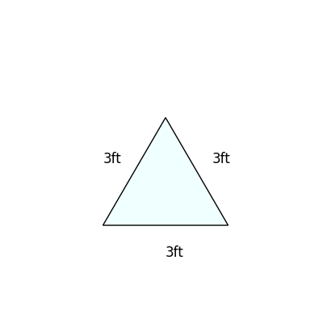

# AVP0545 — Single visual target

DynaMath:18 / MathVista:441 · same type · Numeric representation and conversion

## Shared or similar visual information

The numerical notations 3 ft and 3 cm.

## Evidence locations

- Left image: The 3ft printed below the bottom edge of the light-blue triangle.
- Right image: The 3 cm beside the left side of the cyan triangle.

## Mathematical meanings

Left image: The triangle base measures three feet. Right image: The indicated triangle side measures three centimeters.

## Same mathematical meanings

no

## Rationales

The labels share a numeral, and the displayed units give different physical lengths of 0.9144 meters and 0.03 meters.

Only the selected target is annotated. AI visual-review draft; not independently double-annotated by humans.
