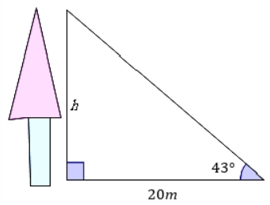
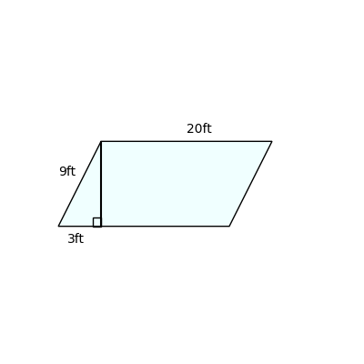

# AVP0546 — Single visual target

MathVerse:347 / DynaMath:34 · same type · Numeric representation and conversion

## Shared or similar visual information

The numerical notations 20 m and 20 ft.

## Evidence locations

- Left image: The 20m beneath the horizontal base of the tree-height construction.
- Right image: The 20ft above the top horizontal edge of the slanted quadrilateral.

## Mathematical meanings

Left image: The horizontal base distance measures twenty meters. Right image: The top side measures twenty feet.

## Same mathematical meanings

no

## Rationales

The labels share a numeral, and the displayed units give different physical lengths of 20 meters and 6.096 meters.

Only the selected target is annotated. AI visual-review draft; not independently double-annotated by humans.
