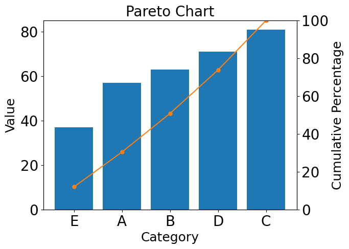
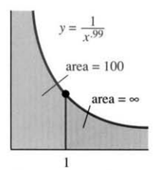

# AVP0547 — Single visual target

DynaMath:459 / MathVista:717 · different type · Numeric representation and conversion

## Shared or similar visual information

The numerical notation 100.

## Evidence locations

- Left image: The notation 100 appears at the top of the right vertical axis.
- Right image: The notation 100 appears in the annotation area = 100 next to the left shaded region.

## Mathematical meanings

Left image: 100 sets the 100 percent point on the cumulative scale. Right image: 100 gives the numerical area of the left shaded region.

## Same mathematical meanings

no

## Rationales

The notation on the left represents a cumulative percentage. The notation on the right represents an area.

Only the selected target is annotated. AI visual-review draft; not independently double-annotated by humans.
