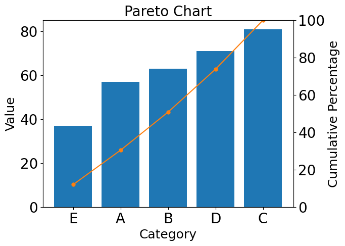
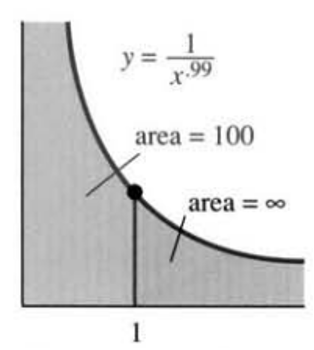

# AVP0547 — Single visual target

DynaMath:459 / MathVista:717 · different type · Numeric representation and conversion

## Shared or similar visual information

The numerical notation 100 in both images.

## Evidence locations

- Left image: The 100 at the top of the right-side Cumulative Percentage axis.
- Right image: The 100 in the label area = 100 pointing to the finite gray region.

## Mathematical meanings

Left image: The selected tick marks cumulative percentage 100. Right image: The finite gray region is assigned area value 100.

## Same mathematical meanings

no

## Rationales

The left context gives the number the role of percentage scale value, while the right context gives it the role of area of a shaded region.

Only the selected target is annotated. AI visual-review draft; not independently double-annotated by humans.
