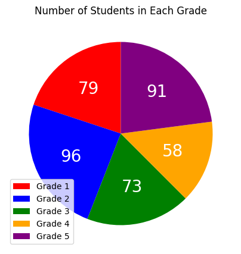
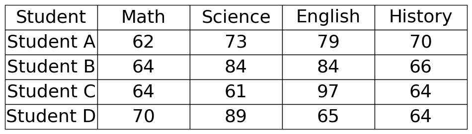

# AVP0548 — Single visual target

DynaMath:428 / DynaMath:426 · different type · Numeric representation and conversion

## Shared or similar visual information

The numerical notation 73.

## Evidence locations

- Left image: The notation 73 appears inside the green Grade 3 sector.
- Right image: The notation 73 appears Student A row and Science column.

## Mathematical meanings

Left image: 73 is the count of Grade 3 students. Right image: 73 is Student A's science score.

## Same mathematical meanings

no

## Rationales

The notation on the left represents a group count. The notation on the right represents a tabulated score.

Only the selected target is annotated. AI visual-review draft; not independently double-annotated by humans.
