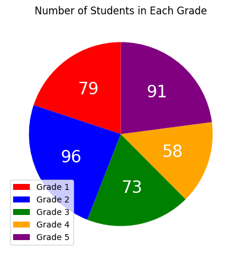
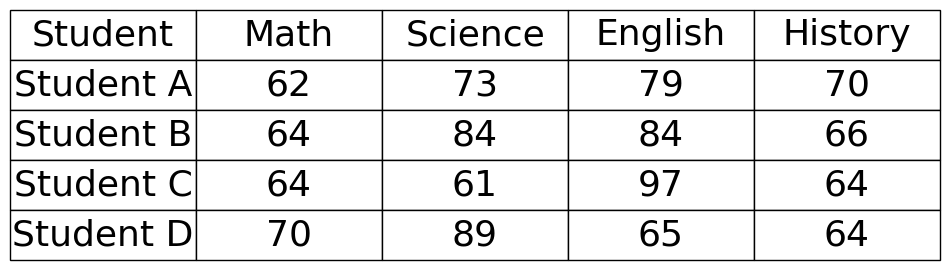

# AVP0548 — Single visual target

DynaMath:428 / DynaMath:426 · different type · Numeric representation and conversion

## Shared or similar visual information

The numerical notation 73 in both images.

## Evidence locations

- Left image: The 73 inside the green Grade 3 slice of the pie chart.
- Right image: The 73 in Student A's Science cell.

## Mathematical meanings

Left image: The pie chart reports 73 students in Grade 3. Right image: The table records Student A's science score as 73.

## Same mathematical meanings

no

## Rationales

The left context gives the number the role of number of students, while the right context gives it the role of score.

Only the selected target is annotated. AI visual-review draft; not independently double-annotated by humans.
