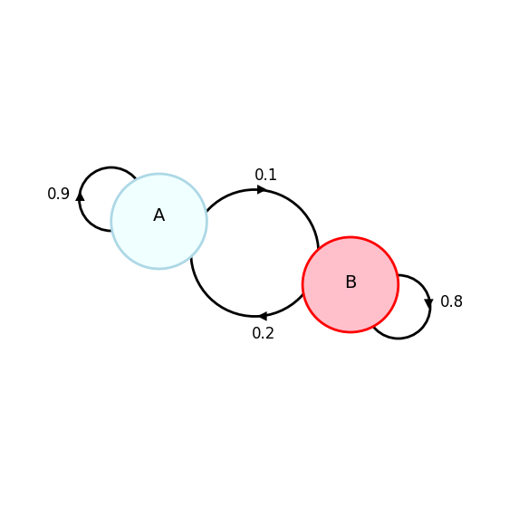

# AVP0549 — Single visual target

DynaMath:72 / MathVerse:556 · different type · Numeric representation and conversion

## Shared or similar visual information

The numerical notation 0.2.

## Evidence locations

- Left image: The notation 0.2 appears on the lower arrow from node B to node A.
- Right image: The notation 0.2 appears first coordinate of the marked point (0.2, 0.98).

## Mathematical meanings

Left image: 0.2 is the transition probability from B to A. Right image: 0.2 is the horizontal coordinate of the marked unit-circle point.

## Same mathematical meanings

no

## Rationales

The notation on the left represents a transition probability. The notation on the right represents a horizontal coordinate.

Only the selected target is annotated. AI visual-review draft; not independently double-annotated by humans.
