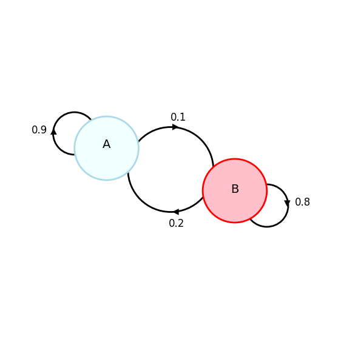
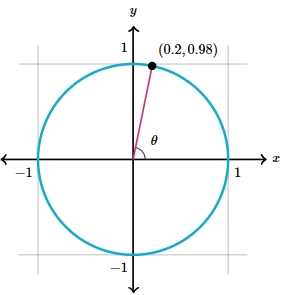

# AVP0549 — Single visual target

DynaMath:72 / MathVerse:556 · different type · Numeric representation and conversion

## Shared or similar visual information

The numerical notation 0.2 in both images.

## Evidence locations

- Left image: The 0.2 beside the lower curved arrow from B toward A.
- Right image: The first component 0.2 in the coordinate label (0.2,0.98) of the marked unit-circle point.

## Mathematical meanings

Left image: The directed connection from B to A is labeled with weight 0.2. Right image: The marked point has x-coordinate 0.2.

## Same mathematical meanings

no

## Rationales

The left context gives the number the role of weight on a directed edge, while the right context gives it the role of horizontal coordinate.

Only the selected target is annotated. AI visual-review draft; not independently double-annotated by humans.
